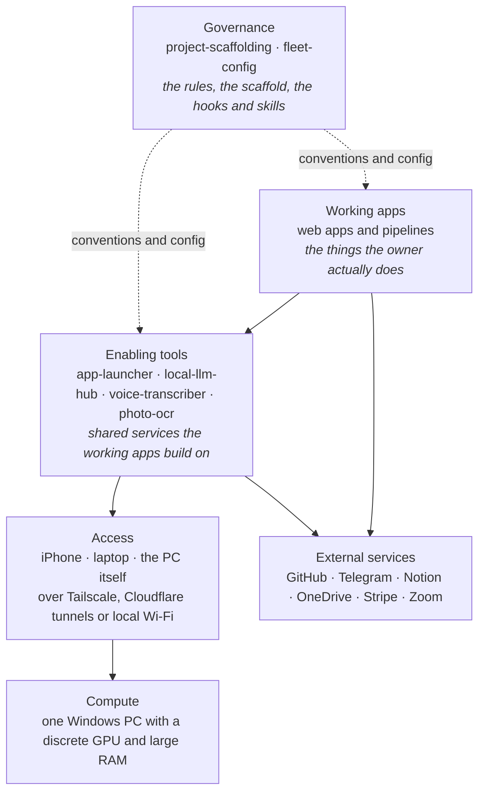
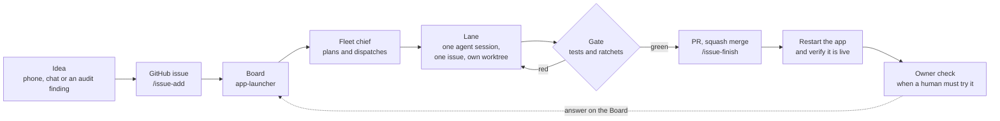

# The fleet guide

This page explains the whole fleet to someone meeting it for the first time: what it is, the layers it is built in, every repo in one line, how a piece of work travels from an idea to a merged change, and the shared mechanisms that keep forty-odd repos behaving like one system. It is written to be read top to bottom. Each section ends by pointing at the file that holds the full detail, because this page explains and links; it does not replace the sources of truth.

## What the fleet is

The fleet is one person's set of software projects: a few dozen sibling git repositories that live side by side in one folder on a single home Windows PC. Some are always-on web apps, some are batch pipelines, some are small experiments, and two of them exist only to govern the others. Every repo is public or private on GitHub under one owner account, and the owner is the only user.

Four ideas shape it:

- **Phone-first.** The owner runs the fleet from an iPhone: one tap launches a coding agent, an app or a job. A desktop session is the exception, not the default.
- **Compose.** Mature apps are web apps with HTTP APIs that other apps consume, so a capability is built once and reused.
- **One hub.** Every LLM call and every speech call goes through one local gateway, never through a wrapper an app writes for itself.
- **Don't diverge.** A convention that one repo discovers flows up into the scaffold repo and from there into every repo, instead of each repo growing its own variant.

Most of the code is written by coding agents (Claude Code first, with Codex, Pi, Copilot CLI and others alongside) working under the rules this repo installs. The owner decides scope, answers questions and validates what an agent cannot prove on its own.

## The layers

The fleet is a stack. Each layer builds on the ones below it, and the repos sit in the top three.

- **Compute.** One home PC is the whole server. Its GPU runs the local language and speech models; nothing in the stack runs on rented cloud machines. Keeping it local is a preference, not a constraint.
- **Access.** The owner reaches the PC from the phone, a laptop or the PC itself. Tailscale, a private mesh network, is the only path to sensitive surfaces such as a live terminal. Cloudflare named tunnels give a few bearer-token-gated surfaces a public address. On the home network, apps answer directly on their local ports.
- **Enabling tools.** The shared services. `app-launcher` is the front door to everything (coding sessions, apps, jobs and the Board where work is planned); `local-llm-hub` is the gateway for every model call; `voice-transcriber` owns the speech-to-text server other apps reuse; `photo-ocr` turns photos into text. Each one is used by more than one working app.
- **Working apps.** What the owner uses day to day, split into interactive web apps (`working-web`) and non-interactive pipelines and batch jobs (`working-pipe`).
- **Governance.** `project-scaffolding` is the canonical template: its `CLAUDE.md`, layout, vendored UI components and ratchet scripts are what every repo derives from. `fleet-config`, this repo, holds the agent configuration installed on the machine: global instructions, hooks, skills, the design system and the architecture map.

The layered narrative, with each repo's port, what it builds on and who consumes it, is [`architecture/ARCHITECTURE.md`](../architecture/ARCHITECTURE.md). The rendered picture is [`architecture/system-map.png`](../architecture/system-map.png), and its text form, with the edges between repos, is [`architecture/system-map.mmd`](../architecture/system-map.mmd).

## Every repo in one line

Each repo describes itself in a `.fleet.toml` file at its root: its layer, an icon and a one-clause description, plus optional port, sub-services and declared dependencies. `/system-map` reads all of them into `architecture/fleet.data.js`, and the tables below are generated from that file, so they always say what the repos say about themselves. A repo that changes its role updates its own `.fleet.toml` in the same PR, and the next map refresh rewrites this list. The schema is in [`architecture/README.md`](../architecture/README.md); what each repo exposes and depends on is in [`architecture/CONTRACTS.md`](../architecture/CONTRACTS.md).

<!-- fleet-repos:start (generated by .claude/skills/system-map/render_guide.py; do not hand-edit) -->

### Governance (`layer = "governance"`, 3 repos)

| | Repo | What it is | Port |
|---|---|---|---|
| 📐 | `project-scaffolding` | Canonical master — the scaffold & CLAUDE.md every project derives from. | — |
| ⚙️ | `fleet-config` | Fleet-wide Claude Code hooks, skills & the issue workflow. | — |
| ⚙️ | `fleet-config-lite` | Copilot-CLI + GitLab lite fork — session-state hook, issue skills & installer. | — |

### Enabling (`layer = "enabling"`, 7 repos)

| | Repo | What it is | Port |
|---|---|---|---|
| 🚀 | `app-launcher` | **Where I live** — phone-first hub: Coding · Apps · Jobs · Life OS · Board. | :8445 |
| 🧠 | `local-llm-hub` | Shared LLM gateway — routes to local models or claude -p. | :8000 |
| 🎙️ | `voice-transcriber` | Always-on voice→text (F8). Owns whisper :8090. | :8443 |
| 📷 | `photo-ocr` | Mobile OCR — photos → clean text. Reusable capture surface. | :8444 |
| 🚀 | `app-launcher-lite` | Copilot + GitLab lite fork of app-launcher: the phone-first launcher hub. | :8465 |
| 🧰 | `fleet-config-lite` | Lite fleet-config: Copilot CLI hooks, issue-workflow skills and installer. | — |
| 🧠 | `local-llm-hub-lite` | Single-machine lite fork of local-llm-hub: local models and whisper on :8000. | :8000 |

### Working apps: web (`layer = "working-web"`, 13 repos)

| | Repo | What it is | Port |
|---|---|---|---|
| 🛒 | `grocery-shopping-automation` | Inventory + shopping PWA, voice audit, HA voice commands + product search. | :8502 |
| 💬 | `whatsapp-radar` | Cut attention load from busy chats. | :8455 |
| 🎤 | `facilitation-suite` | **facilitation-suite** — live workshop app: stage, cockpit, Zoom chat, live copilot. | :8449 |
| 💶 | `family-accounting` | Shared household-expense tracker. | — |
| 🎓 | `vibe-coding-workshop` | Python workshop + exercises. | — |
| 🌱 | `life-os` | Personal productivity skills plus a shared document-archive engine and Outlook email tooling | — |
| 🌡️ | `home-automation` | Home automation: AC, solar, per-circuit energy, alarm, network health, Home Assistant. | :8447 |
| 📊 | `github-copilot-usage` | Local GitHub Copilot usage dashboard: credits, models and sessions from Copilot's own logs. | :8377 |
| 🗂️ | `folder-explorer` | Disk-space explorer and search: folder tree, largest files, file types, folder and mail search. | :8453 |
| 🅿️ | `parking-manager` | Household parking: which days to book, time off and the Thursday release; books them itself. | :8450 |
| 🪞 | `robertoferraro` | robertoferraro.net off Squarespace: same URLs, own design system and form service. | — |
| ✅ | `task-os` | One task list: projects, Inbox capture, calendar, voice add, mail archiving, time tracking. | :8448 |
| 📈 | `website-analytics` | Local-first GA4, Search Console, crawl, and weekly website-insight dashboard. | — |

### Working apps: pipelines (`layer = "working-pipe"`, 8 repos)

| | Repo | What it is | Port |
|---|---|---|---|
| 💳 | `accounting-quarterly` | Stripe payments → quarterly reports. | — |
| 📝 | `content-management` | Content surfaces: reporting, planning, newsletter, podcast and video. | — |
| 📧 | `email-archiver` | Retired: replaced by folder-explorer, kept one release as a fallback. | — |
| 🗂️ | `copilot-studio-transcripts` | Copilot Studio workbench. | — |
| 🤖 | `automation` | Python automation grab-bag. | — |
| ⛏️ | `minecraft-bedrock-bot` | Headless Bedrock Realm bot driven by an LLM decision loop on the hub. | — |
| ☁️ | `oracle-to-gcp` | Oracle SQL → BigQuery translator prototype with mock validation. | — |
| 📈 | `algo-trading` | Rule-based FX trading on major pairs: backtest → paper → live. | — |

<!-- fleet-repos:end -->

## How a piece of work flows

Every change, however small, travels the same path: it starts as a GitHub issue, is built on its own branch by an agent session, must pass the repo's verification gate, and lands as one squash-merged pull request.

1. **An issue holds the plan.** Ideas, plans and roadmaps live as GitHub issues, never as files in a repo. `/issue-add` turns a rough idea into a self-contained issue that a fresh agent could pick up cold. The issue, its closing PR and `git log` are the changelog.
2. **The Board shows the queue.** The Board in `app-launcher` lists open issues and live sessions across every repo. The owner drives it from the phone, usually by talking to the **fleet chief**: a standing agent session that answers questions about the fleet, files issues, and dispatches work.
3. **A lane builds one issue.** The chief (or the owner) starts a **lane**: one agent session working one issue. `/issue-start` claims the repo, and if another session already holds the primary checkout, it builds in an isolated sibling worktree instead, so two lanes never collide. Bugs and chores are built straight away; a new feature first gets a plan the owner approves. The model and effort for a lane are picked by task difficulty from one doc.
4. **The gate decides.** Each repo declares one verification gate (for this repo, `tests/run_acceptance.py`): tests, byte-compiles and the ratchet stages. Nothing ships on a red gate, and a check that cannot establish its result reports "not confirmed", never a pass.
5. **One PR merges.** `/issue-finish` updates the docs, pushes, opens the PR that closes the issue, squash-merges it, deletes the branch and, for a long-lived app, restarts it and confirms the new build is the one running.
6. **The owner validates what a session cannot.** When a change needs a real phone, a live microphone or an account only the owner holds, the issue gets an owner check. It stays on the Board until the owner answers there.

A few rules hold the flow together: one issue per branch and per PR; `main` is always shippable and never committed to directly (the `/quick` skill for tiny changes and the scheduled map refreshes are the named exceptions); agents never commit, push or delete anything outside the agreed scope without the owner's say-so.

Where the detail lives: the workflow rules are in [`global-CLAUDE.md`](../global-CLAUDE.md); the issue skills and the chief are catalogued in [`docs/skills.md`](skills.md) and [`docs/skills/chief.md`](skills/chief.md); concurrent lanes in [`docs/skills/concurrent-same-repo-work.md`](skills/concurrent-same-repo-work.md); owner checks in [`docs/owner-check.md`](owner-check.md); model choice in [`docs/model-tiers.md`](model-tiers.md).

## The shared mechanisms

These are the pieces every repo relies on. Each is built once, in one place, and reused.

### The local LLM hub

`local-llm-hub` serves Anthropic-shape and OpenAI-shape HTTP APIs on the loopback interface and routes each request by model name: Claude and Gemini names go to the subscription command-line tools, open-weight names go to local model servers. Audio transcription goes through the same hub, which knows which machine runs the speech model. An app that needs a model uses a standard SDK pointed at the hub and never wraps an agent CLI itself; when the hub lacks a feature, the fix is a change to the hub. How to call it, and what it cannot do yet, is in [`docs/local-llm-hub-usage.md`](local-llm-hub-usage.md).

### Hooks and skills

This repo installs the agent configuration on the machine. `install.ps1` links its folders into each coding agent's home directory, so a merge here takes effect in every agent session at once.

- **Global instructions.** [`global-CLAUDE.md`](../global-CLAUDE.md) is the one instruction file every agent reads in every repo: the working method, the conventions and the workflow above.
- **Hooks** run on agent events (before a tool call, after an edit, at session start and end). They block what must never happen, such as a secret in a commit or an AI attribution trailer, and nudge what is usually a mistake. Catalogue: [`docs/hooks.md`](hooks.md).
- **Skills** are packaged procedures an agent loads on request: the issue workflow, audits, design and performance reviews, the scheduled weekly sweeps. Catalogue: [`docs/skills.md`](skills.md). Which agent gets which hook and skill is in [`docs/cross-agent-parity.md`](cross-agent-parity.md).
- **Scheduled skills** run unattended every week through `app-launcher` jobs, each from its own launcher beside the skill: the fleet-wide codebase audit and cleanup, the system map, the prompt and context audits, and others. How they run is in [`docs/scheduled-runners.md`](scheduled-runners.md).

### The scaffold and vendored components

`project-scaffolding` publishes reusable pieces: the web-app UI components (navigation, buttons, sheets, toasts, the usage log and more), tray lifecycle scripts and the ratchet scripts. A repo that uses one copies it byte for byte into its own tree and records the scaffold commit it came from in a `[vendored]` table in its `.fleet.toml`. `/propagate-vendored` re-copies a changed component into every adopter, one PR per repo, so no repo carries a quietly edited fork. The catalogue is in the scaffold's [components doc](https://github.com/ferraroroberto/project-scaffolding/blob/main/docs/components.md).

### The ratchet family

A convention that can be checked mechanically is enforced by a ratchet, not by a prose rule or a reviewer's memory. A ratchet is one stdlib script, vendored from the scaffold, configured by a table in `.fleet.toml`, with a committed baseline that records the debt that already exists. It fails the gate when a count rises above its baseline, so old debt never blocks a ship but new debt never lands, and the baseline can only shrink. Exit code 3 means the script could not measure, which counts as a failure. The family covers static analysis, README and docs history, file and function size, issue numbers in comments, instruction-file quality, stale doc references, dead code, the Windows and git conventions, runtime files written beside the code, and usage tracking. This repo's set is listed in [`CLAUDE.md`](../CLAUDE.md); the standing decision is in the [architecture decision register](https://github.com/ferraroroberto/project-scaffolding/blob/main/docs/architecture-decisions.md).

### Usage tracking

Every web app vendors the scaffold's `usage-log` component and mounts its `/api/usage` routes. Every interactive control carries a constant tracking id, and every sheet or dialog records its view on open and hands the view back on close. The owner judges the UX from these usage and time-spent figures, so an untracked control makes them wrong; the usage track ratchet fails a ship that adds one. Rules: the scaffold's [usage track ratchet doc](https://github.com/ferraroroberto/project-scaffolding/blob/main/docs/usage-track-ratchet.md).

### The design system

All fleet web apps share one design system: colour tokens for light and dark, typography, spacing, and the navigation contract (a floating bottom tab pill). It lives in [`design.md`](../design.md) and [`design.dark.md`](../design.dark.md), with the reasoning in [`docs/design-system.md`](design-system.md). `/design-sync` reports drift from it and `/design-review` scores a running app against it.

### The map and the self-describing repos

Each repo's `.fleet.toml` is the single place it says what it is. `/system-map` aggregates them every week into the map data, the rendered picture, the text map, the contracts page and the repo list on this page. A new repo appears on all of them with no central edit. Which repos the fleet-wide tools reach, and which are dormant, is set in `hooks/projects.toml` and explained in [`docs/fleet-scope.md`](fleet-scope.md).

## Where each source of truth lives

| Question | Source |
|---|---|
| The rules every agent follows | [`global-CLAUDE.md`](../global-CLAUDE.md) |
| This repo's own rules and gate | [`CLAUDE.md`](../CLAUDE.md) |
| The decisions in force across the fleet | [architecture decision register](https://github.com/ferraroroberto/project-scaffolding/blob/main/docs/architecture-decisions.md) |
| The template every repo derives from | [project-scaffolding](https://github.com/ferraroroberto/project-scaffolding) and its `CLAUDE.md` |
| What each repo is | its own `.fleet.toml`, aggregated in [`architecture/fleet.data.js`](../architecture/fleet.data.js) |
| The layers, in prose | [`architecture/ARCHITECTURE.md`](../architecture/ARCHITECTURE.md) |
| How repos depend on each other | [`architecture/CONTRACTS.md`](../architecture/CONTRACTS.md) and [`architecture/system-map.mmd`](../architecture/system-map.mmd) |
| Which model a task gets | [`docs/model-tiers.md`](model-tiers.md) |
| Hooks and skills | [`docs/hooks.md`](hooks.md), [`docs/skills.md`](skills.md) |
| Which agent gets what | [`docs/cross-agent-parity.md`](cross-agent-parity.md) |
| Calling a model or transcribing audio | [`docs/local-llm-hub-usage.md`](local-llm-hub-usage.md) |
| Known traps and their fixes | [`docs/recurring-gotchas.md`](recurring-gotchas.md) |
| Plans and open work | GitHub issues in each repo |
